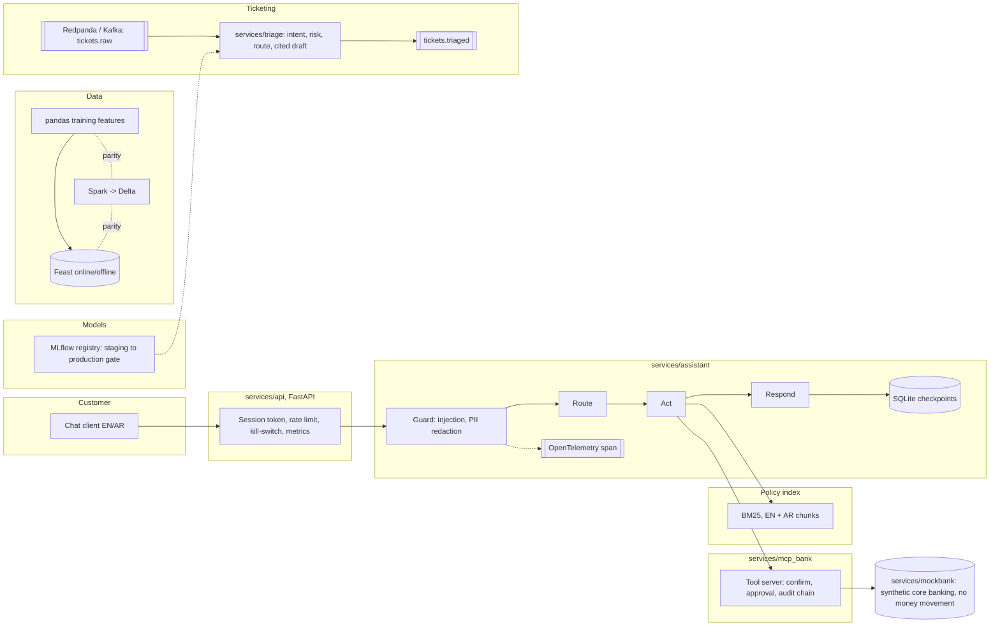

# Architecture (as built)

Matches the code on 2026-10-29. Parts marked *not deployed* exist as code and checks only.

## Components and their checks

| Component | Code | Check |
|---|---|---|
| Gateway | `services/api/app.py` | `tests/test_api.py` (10 tests), container health check |
| Guard | `services/assistant/guardrails.py` | `tests/test_assistant_safety.py`, `ml/eval/red_team.py` |
| Orchestrator | `services/assistant/orchestrator.py` | crash-and-resume test; scenario gate |
| Policy index | `services/assistant/rag/` | `ml/eval/retrieval_eval.py`, `ml/eval/arabic_eval.py` |
| Tool server | `services/mcp_bank/` | ownership, approval and confirmation tests |
| MCP server | `services/mcp_bank/mcp_server.py` (MCP SDK v1, bound to one customer) | `tests/test_mcp_bank.py`, through a real MCP client session |
| Core banking mock | `services/mockbank/bank.py` | no-money-movement test |
| Triage | `services/triage/` | `tests/test_triage.py`, `ml/eval/results/triage_stream.json` |
| Feature store | `feature_repo/`, `ml/pipelines/feast_parity.py` | parity result, 0 mismatches |
| Spark job | `ml/pipelines/spark_features.py`, `spark_parity.py` | parity result, 0 mismatches |
| Registry | `ml/pipelines/registry.py` | gate tests; refused current model |
| Drift | `ml/pipelines/drift.py` | `tests/test_drift.py` |
| Scheduled retrain | `ml/pipelines/retrain.py` | drift-triggered run, gate refused the model |
| Live local stack | `infra/docker/compose.yml` | `ml/eval/stack_check.py`, `ml/eval/rollback_drill.py` |
| Deployment | `infra/` | Helm lint, Terraform validate, promtool check (*not deployed*) |
